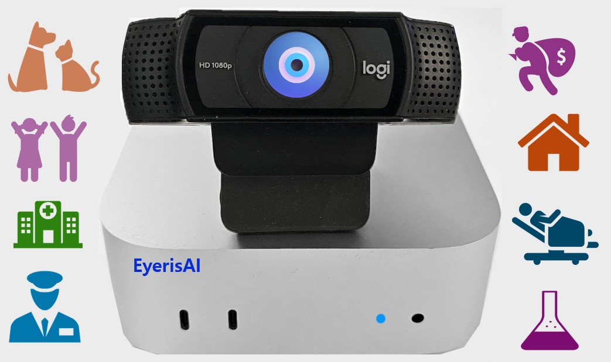
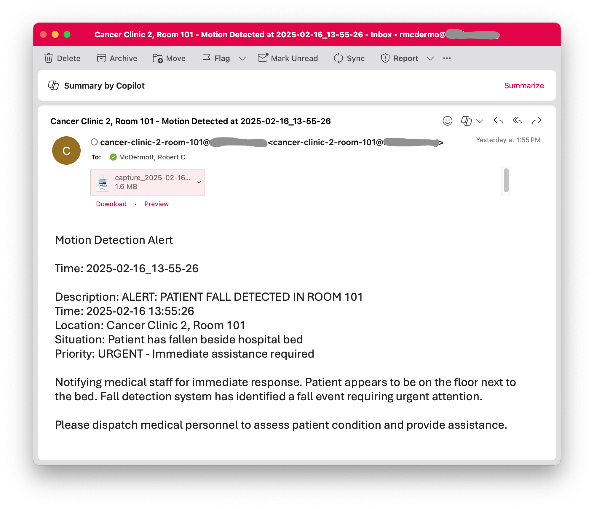
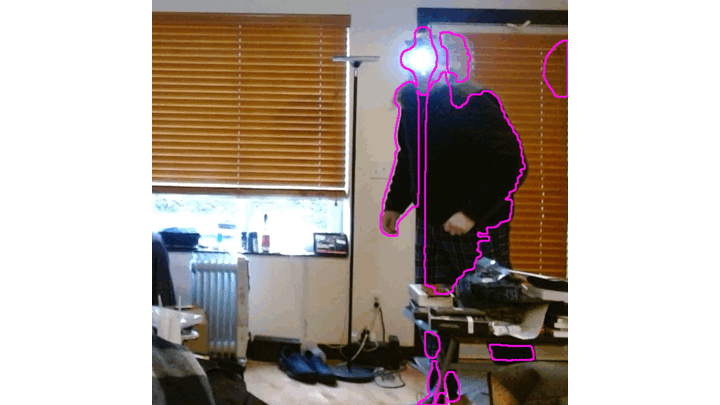
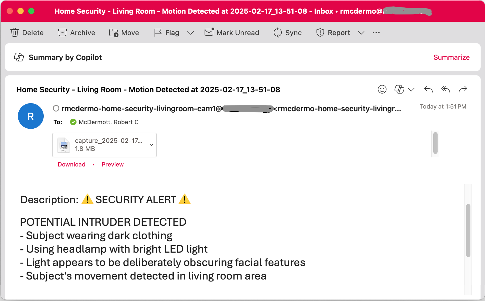

# EyerisAI 🧿
AI powered camera and event detection system

## What is EyerisAI?

EyerisAI (pronounced "IrisAI", 👁️ + 🤖) is a project to create an AI-powered camera and event detection system that uses a computer, webcam, computer vision, and a multi-modal LLM (💻 + 📷 + 👁️ + 🤖) to "watch" for specific events in real time. When it detects an event, EyerisAI uses generative AI to analyze the scene, log the findings, and respond, either by speaking aloud (TTS) or sending an email alert. You simply configure a prompt that tells the AI what to look for and how to react.

**Smart False Alarm Reduction:** EyerisAI features AI-based event filtering that dramatically reduces false alarms. While computer vision detects motion (shadows, wind, pets), the AI evaluates each detection to determine if it matches your specified criteria (e.g., "humans", "person falling", "vehicles"). Only confirmed events are logged, saved, or trigger alerts - eliminating the noise of irrelevant motion.

The project is currently functional but still evolving. EyerisAI can be made more versatile in the future, potentially integrating with webhooks, running commands, or interacting with home automation systems *(send me a PR if you are interested in helping improve it)*. Think of it as an intelligent, customizable surveillance tool that not only watches but actively interprets and responds to what it sees.

## Potential Use Cases

There are many potential applications of an AI enabled camera system. You're imagination is the limit. Here are some potential focus areas and their use cases:

**Healthcare Monitoring**
 - Patient fall detection in medical facilities
 - Elder care movement monitoring
 - Behavioral health observation
 - Emergency response triggering

**Security Applications**
- Intelligent home surveillance
- Business premises monitoring
- Weapon detection
- Suspicious activity alerts

**Family Care**
- Smart baby monitoring
- Child safety oversight
- Pet behavior tracking
- Elderly care assistance

**Professional Monitoring**
- Workplace safety compliance
- Construction site supervision
- Equipment monitoring
- Quality control observation

**Research & Analysis**
- Wildlife observation
- Experimental observation and logging


## Examples

### Hospital Fall Detection

Here's an example of the detecting a patient falling from a hospital bed *(to simulate this event, I used a virtual webcam to feed a youtube video of a commercial for a fall mat to EyerisAI)*. I used a prompt to tell the AI that it was a fall detection system and should report and incidents that it detected:


The resulting email alert that was sent in response to the AI determining that a fall event had occurred:



### Home Security Monitoring

In this example, I captured myself entering my office (wearing a headlamp to obscure my face). I provided a prompt to the AI telling it that it was a security camera and it was to watch for and alert when it detected any activity while I was out of town: 



The email alert that it send me in response to detecting a potential intruder:



## Hardware and Setup used for testing and development

For the development and testing of this system I'm using the following setup:

- Apple M4 Mac Mini, 16GB RAM (base model)
- Logitech C920 HD Pro Webcam
- Ollama 0.5.11
- Moondream2 local LLM
- LiteLLM Proxy (**\*optional\***, not need if only using local models via Ollama)

The above setup will run complexly locally. I also tested integrating with OpenAI models (gpt4o) via Azure AI, and Anthropic (Claude 3.5 Sonnet) via Amazon AWS Bedrock. Both the OpenAI and Anthropic models were accessed via LiteLLM proxy running locally. See my article on how to setup LiteLLM if interested: [Centralizing Multiple AI Services with LiteLLM Proxy](https://robert-mcdermott.medium.com/centralizing-multi-vendor-llm-services-with-litellm-9874563f3062) 

If you are going to run a private LLM like Moondream locally, a GPU is recommended, but not required. Moondream is only 1.8B parameters and requires only 4.5GB to run, so it will technically run without a GPU, but it will take it a minute (guess) to process a detection using just the CPU.  If you are using an OpenAI compatible API located remotely, then a GPU is not used, so even a very low powered system (IOT device?) can be used as an EyerisAI camera node and function well.

## Install

Clone this repository to the system you want to run EyerisAI on:

```bash
git clone https://github.com/robert-mcdermott/EyerisAI.git
```

If you are using ***pip*** 

```bash
cd EyerisAI
pip install -r requirements.txt
```

Alternatively, if you are cool 😎, and are using ***uv***:

```bash
uv sync
```

## Configure

Edit the ***config.ini*** file to suit your needs. Here are some of the most likely variables you'll want to change:

### Reducing False Alarms with AI Filtering

One of the most powerful features of EyerisAI is **AI-based alert filtering**, which dramatically reduces false alarms. When enabled, the system uses a two-stage approach:

1. **Computer Vision** detects any motion (fast, but prone to false positives)
2. **AI Analysis** evaluates if the motion matches your criteria (smart filtering)

Enable AI filtering and specify what to alert on:

```ini
[General]
ai_alert_filtering = true
alert_criteria = humans or people
```

**Common Alert Criteria Examples:**

```ini
# Home security - only alert for people
alert_criteria = humans or people

# Fall detection - only alert for falls
alert_criteria = a person falling or on the ground

# Vehicle monitoring
alert_criteria = vehicles, cars, or trucks

# Pet monitoring
alert_criteria = dogs or cats

# Package delivery
alert_criteria = delivery person or packages

# Specific threat detection
alert_criteria = weapons or suspicious activity
```

**How it works:** When motion is detected, the system captures the frame and asks the AI: "Does this image contain [your alert criteria]?" Only if the AI confirms a match will the event be logged, saved, and trigger alerts. False alarms (shadows, tree movement, lighting changes) are discarded automatically.

**Note:** Set `ai_alert_filtering = false` to disable this feature and alert on all motion detections (original behavior).

### Basic Configuration

Update the name of this camera, where it's located, what its purpose is, or something to identify it:

```ini
[General]
instance_name = Give this Camera a name 
```

Adjust the sensitivity of the motion detection. The **min_area** is the area size in pixels that needs to change to trigger. Smaller is more sensitive, larger is less. The **threshold** is the intensity of pixel value shifts required to trigger detection, smaller is more sensitive, larger is less. **cooldown** is the time to wait before another motion detection even can be triggered to prevent too many events.

```ini 
[MotionDetection]
min_area = 700
threshold = 50
cooldown = 3
```
If you have multiple cameras registered on your system, you may need to change the **device_index** to select the correct camera (this may require some trial and error to find the desired camera):

```ini
[Camera]
device_id = 0
```

If you want the system to speak aloud the AI's response (description of what it sees), change the **enabled** variable int the TTS section to *true*:

```ini
[TTS]
enabled = false
```

In the *AI* section, you select the LLM model that you want to use. If you want to use a local model, make sure that Ollama is installed and that you have pulled the model you want to use. "Moondream" is a good local model to start with. EyerisAI can work with any OpenAI compatible API (like LiteLLM Proxy) and multi-modal LLM.

The *prompt* variable is your base instruction for the AI - describe what you want the AI to examine in the image. When **ai_alert_filtering** is enabled, the system automatically extends your prompt with instructions to evaluate the image against your **alert_criteria** and respond in JSON format. You don't need to modify the prompt for filtering to work.

```ini
[AI]
# Ollama model and endpoint
model = moondream
base_url = http://localhost:11434
# Any OpenAI compatible API endpoint:
#model = gpt4o
#base_url = https://api.openai.com/v1
api_key = sk-12345
# Base prompt - alert_criteria will be automatically added when filtering is enabled
prompt = You are a security camera system that has detected motion. The areas where motion was detected are indicated with magenta contours. Examine the image carefully and describe what you see.
max_tokens = 300
```

There are other things that can be configured or adjusted, such as sending emails, that aren't covered here but should be self explanatory.

## Ollama

If you will be running the AI inference locally on the system with the camera and running EyerisAI, you'll need to first have Ollama running with the models that you'll be using downloaed. I'm not going to cover this in detail here but, I provide detailed instructions in my article ["LLM Zero-to-Hero with Ollama"](https://blog.cubed.run/llm-zero-to-hero-with-ollama-913e50d6b7f0) 

## Running 

Now that all the dependencies are satisfied and you have adjusted the configuration to your specific use case.

To run via Python:

```bash
python EyerisAI.py
```

Or for the cool 😎 ***uv*** folks:

```bash
uv run EyerisAI.py
```

## Output

### Images and Logs

When **alert-worthy events** are detected (or all motion if AI filtering is disabled), the system saves:

- **Images:** PNG files named with date-time stamps in the ***captures*** directory
- **Event Log:** Details about each alert in JSONL format in ***captures/motion_events.jsonl***

When **AI filtering is enabled**, non-alert-worthy motion is printed to the console but NOT saved or logged:
```
Motion detected but not alert-worthy: I see a tree branch swaying in the wind
```

This means your captures directory only contains genuinely important events, and your log file isn't cluttered with false alarms.

### Example Log Entry:

```json
{
  "timestamp": "2025-02-17T13:51:15.599307",
  "image_path": "captures/capture_2025-02-17_13-51-08.png",
  "description": "⚠️ SECURITY ALERT ⚠️\n\nTime: 13:51:08\nDate: 02/17/2025\nLocation: Living Room\n\nPOTENTIAL INTRUDER DETECTED\n- Subject wearing dark clothing\n- Using headlamp with bright LED light\n- Light appears to be deliberately obscuring facial features\n- Subject's movement detected in living room area\n\n",
  "camera": {
    "id": 0,
    "resolution": "1920x1080"
  },
  "motion_detection": {
    "min_area": 700,
    "threshold": 50
  },
  "model": "moondream"
}
```

